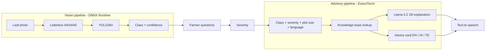

# PlantDoc: Offline Crop Health Assistant

**On-device tomato leaf disease detection, farmer-input severity grading and multilingual agricultural guidance, running entirely on an Android phone.**

Submission for the **Bharat AI-SoC Student Challenge** | Category: Edge AI / On-Device AI / Android

> **Status: working prototype.** PlantDoc gives first-look guidance, not a final diagnosis. Advice, pesticide doses and translations are drafts that still need expert review. See [Limitations](#10-limitations).

**Team:** _<names>_ | **Institution:** _<college>_ | **Mentor:** _<mentor name>_

---

## Table of Contents

1. [Introduction](#1-introduction)
2. [Problem Statement and Objectives](#2-problem-statement-and-objectives)
3. [Feasibility Analysis](#3-feasibility-analysis)
4. [Novelty and Innovation](#4-novelty-and-innovation)
5. [Dataset Preparation](#5-dataset-preparation)
6. [Model Architecture and Training](#6-model-architecture-and-training)
7. [System Architecture and Implementation](#7-system-architecture-and-implementation)
8. [Hardware and Software Requirements](#8-hardware-and-software-requirements)
9. [Results and Performance Analysis](#9-results-and-performance-analysis)
10. [Limitations](#10-limitations)
11. [Challenges and Solutions](#11-challenges-and-solutions)
12. [Conclusions and Future Work](#12-conclusions-and-future-work)
13. [Installation and How to Run](#13-installation-and-how-to-run)
14. [Repository Structure](#14-repository-structure)
15. [Contributing, Licence, References, Acknowledgements](#15-contributing-licence-references-acknowledgements)

---

## 1. Introduction

### 1.1 What is PlantDoc?

A farmer photographs a tomato leaf. The app finds the leaf, names the likely problem, asks four short questions about the plot, and returns advice from a government-sourced knowledge base in English, Hindi or Telugu. The phone's built-in voice can read the advice aloud, and a small Llama model can explain it in words. **Everything runs on the phone with no internet connection. There is no server call anywhere in the pipeline.**

### 1.2 The problem in the field

- **No quick expert access.** Smallholder farmers often cannot reach an extension officer in time to catch a disease before it spreads.
- **Connectivity is unreliable.** Most crop-doctor apps are cloud-based. They need data and send the farmer's photos off the device.
- **Generic advice.** Many apps name a disease and stop, with no plot-specific severity and no guidance in the farmer's language.
- **Trust needs a traceable source.** Pesticide steps must come from a real document, not a model's guess, because a wrong dose has real consequences.

### 1.3 Our solution

- Detects the leaf and its problem **on the phone** (YOLO26n via ONNX Runtime)
- Estimates **severity for the plot** from four farmer questions
- Gives **advice from the NIPHM tomato IPM package** in English, Hindi and Telugu
- Adds an optional **on-device Llama 3.2 1B explanation** (ExecuTorch)
- **Reads advice aloud** with Android's offline text-to-speech
- Says "not sure" below 50% confidence and sends severe cases to an extension officer

### 1.4 What the app is, and is not

| The app is | The app is not |
|---|---|
| A first-look helper pointing to a likely leaf problem and sensible next steps from official guidance | A final diagnosis. Several tomato diseases look alike in photos |
| Offline. Photos and answers stay on the phone | A replacement for an agriculture extension officer |
| A draft whose advice, doses and translations need expert review | Ready for real farmers today |

---

## 2. Problem Statement and Objectives

### 2.1 Objectives

| Objective | Target |
|---|---|
| Detect the disease from a leaf photo | On-device, no internet |
| Estimate severity from the plot, not just the photo | Four short farmer questions |
| Advice in the farmer's language | English, Hindi, Telugu |
| Ground advice in a reviewable source | NIPHM tomato IPM package |
| Explain the advice in plain language | Local LLM, on-device |
| Work without a data connection | 100% offline, including the AI explanation |
| Be honest about uncertainty | "Not sure" below 50% confidence; severe cases routed to an extension officer |

### 2.2 Challenge requirements addressed

| Requirement from the brief | How PlantDoc meets it |
|---|---|
| Detect disease and recommend treatment | YOLO26n detector plus knowledge-base advice |
| Classify severity | Rule-based scoring of four farmer answers (Mild / Moderate / Severe) |
| Local languages, offline | English, Hindi, Telugu; no network use |
| Llama-family model deployed with ExecuTorch | Llama 3.2 1B Instruct (SpinQuant) on ExecuTorch 1.5.1 |
| Two documented pipelines | Vision (ONNX Runtime) and Advisory (ExecuTorch), see [Section 7](#7-system-architecture-and-implementation) |
| Explain uncertainty, route severe cases | Confidence gate at 50%; Severe tells the farmer to contact an extension officer today |

---

## 3. Feasibility Analysis

### 3.1 Technical feasibility

| Component | Technology | Evidence |
|---|---|---|
| Leaf detection | YOLO26n (2.39M parameters, 5.4 GFLOPs) | Test mAP50 0.745; about 0.3 s per photo on the phone |
| Phone runtime for vision | ONNX Runtime | Same top class as PyTorch on 22 of 26 photos |
| Phone runtime for language | ExecuTorch 1.5.1 (XNNPACK) | Llama 3.2 1B running on the test phone |
| Speech | Android TextToSpeech | Offline, built into the OS |

### 3.2 Hardware feasibility

The whole system was developed and measured on a single mid-range phone, a **Redmi Note 13** (Android 15, 8 CPU cores, 5.5 GB RAM). No special accelerator is needed.

### 3.3 Cost feasibility

No cloud, server or subscription cost at run time. Training was done on a laptop with an RTX 3050 4 GB GPU. The detector trained in about 2.2 hours.

### 3.4 Data and licence feasibility

FieldPlant (Roboflow copy) is CC BY 4.0, so it can be used and cited. The licence situation for the other components is in [Section 15](#15-contributing-licence-references-acknowledgements).

---

## 4. Novelty and Innovation

Most on-device plant-disease demos stop at "photo in, disease name out." PlantDoc separates **detection** from **advice** on purpose.

```
Typical demo:   Photo -> Model -> Disease name

PlantDoc:       Photo -> Detector -> Disease
                Farmer answers 4 questions -> Severity
                Disease + Severity -> Reviewed knowledge base -> Advice (EN/HI/TE)
                Advice -> Optional Llama explanation (never the source of the advice)
```

The Llama model **never decides the diagnosis and never writes a pesticide dose**. It only rephrases what the knowledge base already says, and doses are added by the app itself after the explanation. This keeps the one part of the app that could cause real harm out of a generative model's hands.

### Novel contributions

1. **Two independent on-device pipelines.** ONNX Runtime for vision, ExecuTorch for language. A bug or hallucination in the language model cannot change the diagnosis or dose.
2. **A knowledge base with a citable source.** Tomato advice is built from the NIPHM AESA-based IPM package (Government of India), not generated by a model.
3. **Safety-filtered pesticide advice.** Old and restricted chemicals were removed (phorate, dichlorvos, monocrotophos, captafol as foliar spray, dimethoate on raw-eaten vegetables). Spray options show only for Moderate or Severe problems and only at 50% confidence or above. Every list carries a label, protective-clothing and pre-harvest-interval warning.
4. **Severity from structured farmer questions.** A photo shows one leaf, but severity depends on how many plants are affected and how fast it spreads. The questions follow the NIPHM five-spots, five-plants method (25 plants as the starting count).
5. **Multilingual from the start.** English, Hindi and Telugu interface and advice, using sentence-level reviewed translations, with no live machine translation.
6. **Read-aloud accessibility.** Sentence-by-sentence offline speech with Pause, Resume and Stop, useful for low-literacy users.
7. **Honest uncertainty handling.** The app admits when it is not sure instead of guessing.

---

## 5. Dataset Preparation

### 5.1 Why the data changed

The project began with about 500 tomato photos sorted into folders. Classifiers trained on them (MobileNetV3-Small, EfficientNet-B0) scored roughly 54 to 65% on a 98-photo validation set, and the tiny set meant one photo moved the score by about 1 point. Auditing showed the limit was the **data, not the model**:

- Some photos contained several leaves or looked like two diseases at once.
- Seven pairs of near-identical photos sat in two different class folders (14 images), so at least one label in each pair was wrong.
- Wrong predictions often came with 75 to 93% confidence, so confidence alone could not be trusted.

The project therefore moved from whole-photo classification to **leaf-level detection on expert-annotated field photos**.

### 5.2 Source dataset: FieldPlant

| Item | Value |
|---|---|
| Source | FieldPlant, expert-annotated under plant pathologist supervision (Roboflow copy, CC BY 4.0) |
| Original size | 5,170 field photos, 8,629 leaves, 27 classes (cassava, maize, tomato) |
| After cleaning | 4,974 photos, 17 classes |

### 5.3 Leak-free grouped split

A custom script (`split_yolo_dataset.py`) re-split the dataset without modifying the original folder:

- **Copy grouping.** Exact copies, near-copies (perceptual hash) and Roboflow augmentation copies stay together in one split, so a validation photo can never also be a training photo.
- **Conflicts removed.** 36 groups (72 files) whose near-copies carried different classes were left out.
- **Dropped classes (9)**, all with under about 40 leaves: Cassava Bacterial Blight, Corn Charcoal, Corn Chlorotic Leaf Spot, Corn Insects Damages, Corn Purple Discoloration, Corn Smut, Corn Violet Decoloration, Corn Yellow Spots, Tomato bacterial wilt.
- **Merged.** Tomato mosaic virus (19 leaves) and Tomato yellow virus (115) became one class, **Tomato virus**.
- **Result.** 17 classes (cassava 4, maize 9, tomato 4).

| Split | Photos |
|---|---|
| Train | 3,986 |
| Validation | 499 |
| Test | 489 |

### 5.4 Domain gap

The photos come from other farms and varieties, not Indian fields. Accuracy on Indian photos is untested and likely lower. A local labelled test set of 100 to 200 photos is the first next step.

### 5.5 Knowledge base

`knowledge_base.json` (version 0.2-draft) holds one entry for each of the 17 detector classes. Tomato entries are complete drafts. Each entry covers what the problem is, pests to check and why, effects if untreated, actions by severity, prevention, advice for a small plot or a field, when to call for help, and sources.

| Source | How it was used |
|---|---|
| NIPHM / DPPQS AESA-based IPM Package No. 18 (Tomato) | Symptoms, cultural measures, vector control, per-acre reference doses |
| National Horticulture Board tomato notes | Symptom descriptions only (its chemical advice is outdated) |
| India banned and restricted pesticide lists (CIB&RC, to 31 March 2024) | Safety filter |

Only products from the NIPHM list that do not appear on banned or restricted lists were kept: mancozeb, azoxystrobin, copper oxychloride, cymoxanil plus mancozeb, streptocycline, imidacloprid, thiamethoxam, spiromesifen. Organic and biological options were deliberately left out for now.

---

## 6. Model Architecture and Training

### 6.1 Detector

| Item | Value |
|---|---|
| Model | YOLO26n (Ultralytics), 2.39M parameters, 5.4 GFLOPs |
| Input | 640 x 640 (letterbox with grey padding, divide by 255, no ImageNet mean/std) |
| Training | 95 epochs (best epoch 65), early stopping, about 2.2 hours |
| Hardware | RTX 3050 4 GB laptop GPU, Ultralytics 8.4.213, PyTorch 2.14 |
| Export | ONNX, input `[1,3,640,640]`, output `[1,300,6]` = x1, y1, x2, y2, confidence, class id. No separate NMS step is needed |

### 6.2 Detector accuracy

| Split | Precision | Recall | mAP50 | mAP50-95 |
|---|---|---|---|---|
| Validation (499 photos) | 0.790 | 0.755 | 0.817 | 0.625 |
| Test (489 photos) | 0.753 | 0.680 | 0.745 | 0.586 |

The validation-to-test drop is reported deliberately. The best epoch was picked on validation and several classes have very few leaves, so **the test number is the honest estimate**.

### 6.3 Per-class results on the test split (tomato classes)

| Class | Test leaves | Recall | mAP50 | Comment |
|---|---|---|---|---|
| Tomato Brown Spots | 199 | 0.824 | 0.899 | Strong |
| Tomato blight leaf | 41 | 0.780 | 0.828 | Good |
| Tomato healthy | 28 | 0.535 | 0.604 | Weak: misses almost half of healthy leaves |
| Tomato virus | 13 | 0.538 | 0.386 | Weak and noisy (13 leaves); mosaic is often missed |

The detector also knows cassava and maize classes. The app is tomato-only for now because tomato is the crop whose knowledge base and testing are done.

### 6.4 Severity

A no-training colour rule (counting brown, yellow and dark pixels inside each leaf box) was tested first and **failed**: only 48% of healthy leaves scored under 10%, because soil, straw and naturally yellow leaves look like disease to a colour rule. The app therefore asks the farmer four questions (plants checked, plants affected, is it spreading, has it rained recently) and turns the share of affected plants into Mild, Moderate or Severe. The thresholds are a first draft and must be checked against extension guidance. A trained lesion-segmentation model (about 200 labelled leaf crops) is planned.

### 6.5 Language model

| Item | Value |
|---|---|
| Model | Llama 3.2 1B Instruct, SpinQuant, ExecuTorch `.pte` (about 1 GB) with `tokenizer.json` |
| Runtime | `org.pytorch:executorch-android` 1.5.1 (XNNPACK, tuned for Arm CPUs) |
| Role | Writes a short explanation from supplied facts only. Never decides the diagnosis or writes doses |
| Language | English. Hindi and Telugu use reviewed translated text, which is instant and always says the same thing (Llama 3.2 does not officially support Telugu, and a repeated sentence was seen in Llama's Hindi output) |

---

## 7. System Architecture and Implementation

### 7.1 Two on-device pipelines



**Why two pipelines:** the detector is small and fast, while Llama is large and slow. Their failure modes and correctness requirements differ, so each uses the runtime that suits it. A mistake in the language model can never silently change the diagnosis or the dose.

### 7.2 The seven steps of the app

| # | Step | Technology |
|---|---|---|
| 1 | Photo from camera or gallery | Android, EXIF rotation fix |
| 2 | Find leaf and disease | YOLO26n, ONNX Runtime |
| 3 | Ask four questions | App logic |
| 4 | Severity: Mild / Moderate / Severe | Rule-based scoring |
| 5 | Advice | Knowledge base from NIPHM package |
| 6 | Explanation | Llama (English) or reviewed text (Hindi, Telugu) |
| 7 | Listen | Android offline TextToSpeech |

Steps 2 and 6 use AI models. The rest is ordinary program logic and reviewed text.

### 7.3 Advice chain shown per answer

Finding, plot context, pests to check, actions by severity, prevention, spray options (Moderate or Severe only), effects if untreated, when to call for help, source.

### 7.4 Safety rules in the app

- Below 50% confidence or when nothing is found: "not sure, please take a clearer photo."
- Severe: contact an extension officer today.
- Pesticide doses are fixed text from the knowledge base and are appended after the AI explanation, so the model has no path to write one.
- No INTERNET permission is required. Photos and answers stay on the phone, and only the language choice is saved.

### 7.5 Main source files

| File | Job |
|---|---|
| `MainActivity.kt` | Screens (language, home, scan, result) and app flow |
| `YoloDetector.kt` | Loads the detector, letterbox, inference, box decoding |
| `KnowledgeBase.kt` | Loads `knowledge_base.json` and the Hindi/Telugu translation files |
| `AdvisoryEngine.kt` | Builds advice by severity and runs Llama via ExecuTorch |
| `Tools.kt` | Farmer questions and severity rule |
| `SectionReader.kt` | Read-aloud with Pause, Resume, Stop |
| `Usage_monitor.kt` | Usage and performance screen (device and model timings) |
| `Usage_monitor.kt` | Usage and performance screen (device and model timings) |

---

## 8. Hardware and Software Requirements

### 8.1 Test device

| Item | Spec |
|---|---|
| Phone | Xiaomi Redmi Note 13, Android 15, 8 CPU cores, 5.5 GB RAM |
| Development PC | Windows laptop, RTX 3050 4 GB GPU |

### 8.2 Software

| Layer | Technology |
|---|---|
| Detection model | YOLO26n (Ultralytics), PyTorch |
| Export and runtime | ONNX, ONNX Runtime |
| Advisory language model | Llama 3.2 1B Instruct (SpinQuant) |
| Advisory runtime | ExecuTorch 1.5.1 (XNNPACK) |
| App | Kotlin, Android Studio, androidx.exifinterface |
| Accessibility | Android TextToSpeech (offline) |

### 8.3 Storage on the phone

| File | Size |
|---|---|
| Detector (ONNX) | about 9.8 MB (9.4 MB shown in app) |
| Llama `.pte` | about 1,032 MB (copied to the app's files folder, not bundled in the APK) |
| `tokenizer.json` | about 9 MB |

---

## 9. Results and Performance Analysis

### 9.1 Detection accuracy

See [Section 6.2](#62-detector-accuracy) and [6.3](#63-per-class-results-on-the-test-split-tomato-classes).

### 9.2 PC and phone parity

ONNX and PyTorch agreed on the top class for **22 of 26 photos**, with a mean confidence difference of 7.9 points. The four differences were weak detections (26 to 36%) plus one Mildew versus Leaf-blight flip. ONNX Runtime on the PC took about 27 ms per photo.

### 9.3 On-device performance (Redmi Note 13)

| Item | Value |
|---|---|
| Detector load time | 2,501 ms |
| Detector inference | 288 to 290 ms per photo in the latest runs |
| Llama time to first token | 33.4 s |
| Llama generation | 159 tokens in 59.5 s (6.06 tokens/s) |
| Llama end-to-end | about 1 minute; earlier runs measured 58 to 83 s including model load |

Detector timing varied across sessions (279 ms on the first run, 1.5 to 1.9 s on some later runs). The cause (warm-up, debug build or thermal throttling) is still to be measured, so 5 repeated timings per photo are planned. The Llama step is optional and clearly labelled slow, so a farmer is never blocked on it to get the diagnosis and advice.

### 9.4 External photo check

On 14 outside photos the app was correct or plausible on a clear early-blight leaf (93%), a healthy tomato leaf and a bacterial-spot leaf. It gave no detection on both mosaic-virus photos and two others, and made one wrong-crop result. This confirmed the weak classes and the need for a local test set.

### 9.5 Testing summary

Dataset-level test split, PC parity check, external photo tests and on-device tests. Known failures are documented, not hidden. Full detail: [docs/TESTING_AND_VALIDATION.md](docs/TESTING_AND_VALIDATION.md).

---

## 10. Limitations

- Training photos come from other farms and varieties. Accuracy on Indian fields is untested.
- Weak classes: tomato healthy (recall 0.54) and tomato virus (13 test leaves). Mosaic virus is often missed.
- Broad class names: "Tomato Brown Spots" and "Tomato blight leaf" are not exact diseases (Septoria, bacterial spot, early and late blight look alike), so advice for them is general.
- Severity depends on farmer input and uses draft thresholds. It is not measured from the photo.
- Pesticide doses are reference values from an older NIPHM edition and must be checked against the current CIB&RC label.
- Hindi and Telugu text are drafts pending native-speaker review. The Telugu voice may need to be installed in phone settings.
- Llama takes about a minute on the test phone and is not used for Hindi or Telugu.
- Capture currently returns a low-resolution thumbnail. Gallery photos are unaffected.

Full list: [docs/LIMITATIONS_AND_FUTURE_SCOPE.md](docs/LIMITATIONS_AND_FUTURE_SCOPE.md).

---

## 11. Challenges and Solutions

| Challenge | How it was handled |
|---|---|
| Early classifiers capped at about 54 to 65% | Audit found label conflicts and duplicate photos; moved to expert-labelled FieldPlant and leaf-level detection |
| Train/test leakage through near-copy photos | Grouped split by perceptual hash; conflicting groups removed |
| Colour-based severity failed (48% of healthy leaves under 10%) | Replaced by four farmer questions; lesion segmentation planned |
| Risk of a language model inventing a pesticide dose | Llama only explains; doses are fixed text appended by the app |
| Llama is slow on the phone (about 1 minute) | Kept optional and labelled; instant rule-based advice is always shown first |
| Llama does not support Telugu and repeated sentences in Hindi | Hindi and Telugu use reviewed translated text |
| Outdated or banned chemicals in older source documents | Safety filter against banned and restricted lists; only current-listed products kept |
| Translation files got mixed up during a manual merge | Merge scripts excluded from the repo; a language-purity checker validates each file; translations redone from the reviewed source |
| Broken JSON (duplicate keys, stray brace) | `check_kb.py` validator added |
| Build problems (Gradle download, ExecuTorch version, missing Kotlin files) | Version 1.5.1 used; files added to the `com.plantdoc.app` package; assets named exactly as the code expects |

---

## 12. Conclusions and Future Work

### 12.1 Achievements

- Fully offline leaf detection, severity grading, multilingual advice, read-aloud and AI explanation on a mid-range phone
- Test mAP50 0.745 on a leak-free split, reported with weak classes
- A knowledge base grounded in a government source, with unsafe chemicals filtered out
- An architecture where the language model cannot affect the diagnosis or dose

### 12.2 Future scope

**Next (priority order)**

1. Expert review of advice, doses and translations by an agronomist and native speakers
2. A local, India-collected labelled test set (100 to 200 photos) and confidence calibration
3. Lesion-segmentation severity measured from the photo
4. Full-resolution camera capture
5. Faster Llama inference (quantization, smaller model, caching)

**Later**

- Pest detector with a Disease/Pest switch (IP102 lacks fruit borer, *Bemisia tabaci* and cassava pests, so other sources are needed)
- Maize and cassava knowledge bases (the detector already knows these crops)
- Farmer-friendly home, history and traffic-light result screens

---

## 13. Installation and How to Run

Full guide: [docs/INSTALLATION_AND_SETUP.md](docs/INSTALLATION_AND_SETUP.md). In short:

1. Open `android_app/` in Android Studio and let Gradle sync. Dependencies include `onnxruntime-android`, `androidx.exifinterface` and `org.pytorch:executorch-android:1.5.1`.
2. Confirm these are in `app/src/main/assets/`: the ONNX model, `class_names.json`, `knowledge_base.json`, `translations_hi.json`, `translations_te.json`.
3. Connect an Android phone with USB debugging and press Run.
4. Optional, for the AI explanation: push `llama_3_2_1b_xnnpack_spinquant.pte` and `tokenizer.json` to `/sdcard/Android/data/com.plantdoc.app/files/` (Device Explorer or `adb push`). See [android_model/README.md](android_model/README.md).

Python side (dataset prep, training, evaluation, export):

```bash
pip install -r requirements.txt
python scripts/dataset/split_yolo_dataset.py
python scripts/training/train_yolo26_disease.py
python scripts/export/export_yolo26_onnx.py
```

**Quick test:** choose a language, scan a tomato leaf from the gallery, answer the four questions, switch language and check all text changes, tap Listen, then try Explain with AI in English.

---

## 14. Repository Structure

```
PlantDoc/
+-- README.md
+-- CONTRIBUTING.md
+-- requirements.txt
+-- docs/            reports, architecture, setup, user guide, testing, limitations
+-- scripts/
¦   +-- dataset/           dataset splitting
¦   +-- training/          main training + classification_experiments/
¦   +-- evaluation/        external + internal test scripts
¦   +-- export/            ONNX export
¦   +-- knowledge_base/    knowledge-base and language-purity checks
+-- android_model/   ONNX model, class names, model config, Llama download notes
+-- android_app/     Android Studio project
+-- results/
¦   +-- training/          curves, logs (weights excluded)
¦   +-- external_testing/  annotated external photos
+-- screenshots/     app screenshots
```

---

## 15. Contributing, Licence, References, Acknowledgements

**Contributing.** See [CONTRIBUTING.md](CONTRIBUTING.md). Open an issue first, cite a source for any knowledge-base or translation change, keep pull requests small and tested, and never commit datasets, model weights (`.pt`, `.pte`), API keys or personal data.

**Licence.** No licence has been chosen yet. Ultralytics YOLO is AGPL-3.0, which affects how this project can be licensed, so choose one before making the repository public. Third-party: FieldPlant (Roboflow copy) CC BY 4.0; Llama 3.2 Community Licence (**Built with Llama**); PlantSeg CC BY-NC-ND and IP102 academic use only, not redistributed here.

**References**

- Moupojou et al., *FieldPlant*, IEEE Access, 2023
- NIPHM / DPPQS, AESA-based IPM Package No. 18 (Tomato), Government of India
- National Horticulture Board, tomato disease notes
- Wu et al., *IP102*, CVPR 2019; Wei et al., *PlantSeg*, 2024 (planned severity and pest work)
- Meta Llama 3.2 model card; PyTorch ExecuTorch and ONNX Runtime documentation; Ultralytics YOLO26 documentation

More: [docs/REFERENCES_AND_ACKNOWLEDGEMENTS.md](docs/REFERENCES_AND_ACKNOWLEDGEMENTS.md).

**Acknowledgements.** Government of India NIPHM / DPPQS for the tomato IPM package, the FieldPlant authors, Ultralytics, the ONNX Runtime and PyTorch ExecuTorch teams, and Meta for Llama 3.2.


